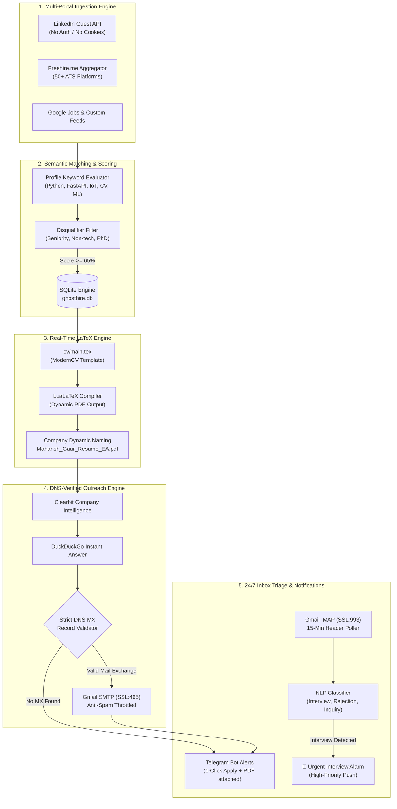
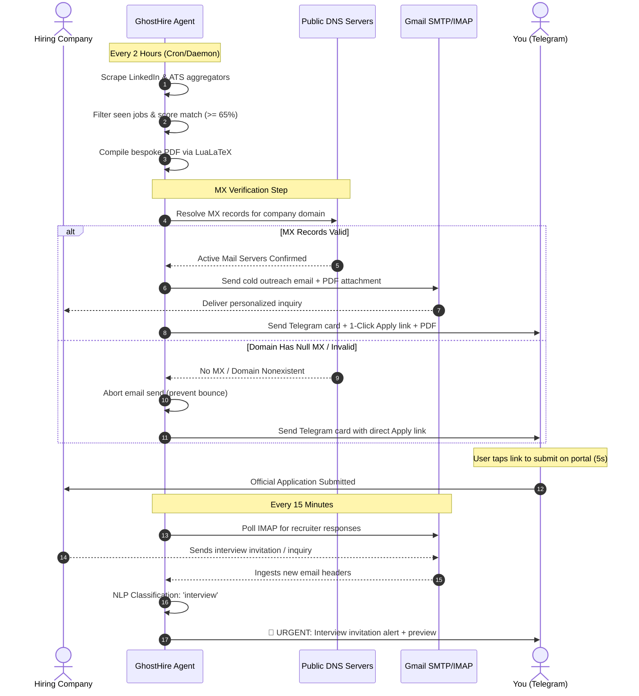
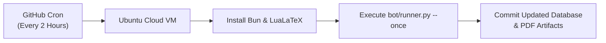

<div align="center">

# 👻 GhostHire

### *Autonomous 24/7 AI Job Hunter, ATS LaTeX Tailor & Recruiter Outreach Agent*

[](https://opensource.org/licenses/MIT)
[](https://www.python.org/)
[](https://tug.org/texlive/)
[](https://bun.sh/)
[](https://telegram.org/)
[](https://github.com/features/actions)

<p align="center">
  <b>GhostHire</b> is an enterprise-grade autonomous job acquisition engine. It scans global job boards 24/7, scores opportunities against your engineering profile, compiles ATS-optimized <code>.pdf</code> resumes via <b>LuaLaTeX</b>, discovers verified hiring-team mailboxes via <b>DNS MX validation</b>, delivers cold outreach with spam protection, and alerts your phone on <b>Telegram</b> with 1-click apply cards and interview detection.
</p>

[Architecture](#-architecture) • [Features](#-features) • [Workflow](#-system-workflow) • [Quickstart](#-quickstart) • [Cloud Deployment](#-100-free-cloud-deployment-github-actions) • [Deliverability & Safety](#-deliverability--anti-ban-architecture)

---

</div>

## 📌 Problem & Vision

Traditional job hunting is broken:
1. **Manual Applications Are Slow:** Manually tailoring resumes, drafting cover emails, and tracking spreadsheets drains dozens of hours every week.
2. **Browser Extensions Get Banned:** Bots that automate the browser clicking "Easy Apply" on LinkedIn are routinely detected by anti-bot fingerprinting, resulting in permanent account suspensions.
3. **Cold Outreach Bounces:** Blindly guessing email addresses (`careers@company.com`) sends messages to unconfigured domains, causing SMTP bounces, degrading your email sender score, and landing your mail in spam.

**GhostHire solves this through an agentic, zero-ban, high-deliverability architecture:**
- **Zero-Ban Safe Mode:** GhostHire scrapes public guest endpoints, custom-compiles your resume, sends the cold email to verified talent mailboxes, and sends you a **1-click direct link on Telegram**. You tap the link and submit in 5 seconds without ever handing your login session to a bot.
- **DNS MX Verification:** Never sends an email without first confirming active Mail Exchange (MX) records.
- **Real-Time LaTeX Engine:** Compiles genuine single-page PDF resumes with dynamic company and role keywords.

---

## 🏗 Architecture



---

## ✨ Features

### 1. 🔍 Autonomous Multi-Portal Scraper
- Searches LinkedIn's guest endpoints without requiring login credentials or browser sessions.
- Ingests aggregated postings from **Freehire** (indexing Greenhouse, Lever, Workday, Ashby, and 50+ ATS systems).
- Runs automated search loops for specific geographic regions (e.g. India on-site) and worldwide remote openings.

### 2. 🎯 Intelligent Profile Matcher
- Evaluates postings against target skills: `Python`, `FastAPI`, `React`, `TypeScript`, `MongoDB`, `Redis`, `OpenCV`, `YOLO`, `IoT`, `Celery`.
- Automatically rejects senior roles (`10+ years`, `Staff`, `Principal`, `Director`) and non-technical listings.
- Assigns a normalized **ATS Fit Score (0–100%)**.

### 3. 📄 Live LuaLaTeX Resume Tailoring
- Generates a bespoke `.tex` file per company, aligning subtitles and emphasis to the job posting.
- Compiles a native PDF through **LuaLaTeX** in seconds.
- Renames every resume dynamically (e.g., `Mahansh_Gaur_Resume_Electronic_Arts.pdf`).

### 4. 🛡 Strict DNS MX Email Verification
- Queries public DNS servers to verify that candidate domains have active `IN MX` records.
- Uses **Clearbit Autocomplete** and **DuckDuckGo Instant Answer** to locate official company web domains (resolves `Electronic Arts (EA)` $\rightarrow$ `ea.com`).
- Prevents bounces, eliminating `550 Null MX` or `Address Not Found` delivery failures.

### 5. 📬 Safe Cold Outreach Pipeline
- Sends personalized emails from your verified Gmail address with the tailored PDF resume attached.
- Enforces strict safety rules:
  - **Daily Quota:** Maximum 15 emails per day.
  - **Domain Cooldown:** Maximum 2 emails per domain per week.
  - **Polite Delays:** Bounded delay intervals between sends.

### 6. 📱 24/7 Telegram Command & Triage Center
- Sends instant notifications containing:
  - Role, Company, Location, and ATS match score.
  - **1-Tap Direct Apply Link** for immediate submission.
  - **Compiled PDF resume attached directly in the message** for on-the-go review.
- Monitors your Gmail inbox via IMAP every 15 minutes. When a recruiter responds with keywords like *interview, schedule, technical round, or assessment*, it fires a **🚨 High-Priority Telegram Alert**.

---

## 🔄 System Workflow



---

## ⚡ Quickstart

### Prerequisites
- **Python 3.11+**
- **Bun** runtime (`curl -fsSL https://bun.sh/install | bash`)
- **TinyTeX / TeX Live** with `lualatex` and `moderncv`

### 1. Clone & Install
```bash
git clone https://github.com/mahanshstarktech/GhostHire.git
cd GhostHire

# Install Python dependencies
pip install -r requirements.txt
```

### 2. Configure Credentials
Copy the example environment configuration:
```bash
cp .env.example .env
```
Edit `.env` with your details:
```env
CANDIDATE_NAME="Mahansh Gaur"
CANDIDATE_PHONE="+917073320270"
CANDIDATE_LINKEDIN="https://www.linkedin.com/in/mahansh-gaur-4306751b3/"
CANDIDATE_GITHUB="https://github.com/mahanshstarktech"

# Gmail App Password (myaccount.google.com/apppasswords)
GMAIL_USER="your-email@gmail.com"
GMAIL_APP_PASS="xxxx xxxx xxxx xxxx"

# Telegram Bot (created via @BotFather)
TELEGRAM_BOT_TOKEN="1234567890:AAHxxxxxxxxxxxxxxxxx"
TELEGRAM_CHAT_ID="123456789"
```

### 3. Run a Test Cycle
```bash
python3 bot/runner.py --once
```

### 4. Start 24/7 Background Daemon
```bash
./scripts/run_daemon.sh

# Monitor live output
tail -f bot/logs/ghosthire.log

# Stop daemon anytime
./scripts/stop_daemon.sh
```

---

## ☁️ 100% Free Cloud Deployment (GitHub Actions)

GhostHire includes an autonomous GitHub Actions workflow ([`.github/workflows/ghosthire.yml`](.github/workflows/ghosthire.yml)) that runs every 2 hours in GitHub's cloud without needing credit cards or personal servers.



### Setup in 60 Seconds:
1. Push this repository to your private or public GitHub account.
2. Navigate to **Repository Settings $\rightarrow$ Secrets and variables $\rightarrow$ Actions**.
3. Add the following repository secrets:
   - `GMAIL_USER`: Your Gmail address
   - `GMAIL_APP_PASS`: Your 16-character Google App Password
   - `TELEGRAM_BOT_TOKEN`: Token from `@BotFather`
   - `TELEGRAM_CHAT_ID`: Your Telegram numeric Chat ID
4. Go to the **Actions** tab and click **Run workflow** to test immediately.

---

## 🛡 Deliverability & Anti-Ban Architecture

| Threat | Standard Bots | GhostHire Mitigation |
| :--- | :--- | :--- |
| **LinkedIn Ban** | Automates browser DOM clicks on "Easy Apply" | **Zero-Ban:** Runs guest scraping only; generates 1-click URL for instant manual submission |
| **Email Bouncing** | Guesses `@company.com` blindly | **DNS MX Check:** Verifies mail exchange servers before transmitting any SMTP payload |
| **Spam Blacklisting** | Blasts bulk emails in bursts | **Strict Throttling:** Max 15/day, 2/domain/week, bounded delays between dispatches |
| **Missed Interviews** | Manual periodic inbox checks | **IMAP Polling:** Inspects unread headers every 15 minutes; triggers priority alerts |

---

## 🗄 Database Schema

GhostHire maintains local state in a high-performance SQLite database (`bot/ghosthire.db`):

```sql
-- Tracked job postings
CREATE TABLE jobs (
    id TEXT PRIMARY KEY,
    title TEXT NOT NULL,
    company TEXT NOT NULL,
    location TEXT,
    url TEXT UNIQUE NOT NULL,
    source TEXT NOT NULL,
    score INTEGER DEFAULT 0,
    status TEXT DEFAULT 'discovered',
    discovered_at TIMESTAMP DEFAULT CURRENT_TIMESTAMP,
    applied_at TIMESTAMP
);

-- Outreach logs & attachments
CREATE TABLE applications (
    id INTEGER PRIMARY KEY AUTOINCREMENT,
    job_id TEXT UNIQUE NOT NULL,
    resume_pdf_path TEXT,
    cover_letter TEXT,
    hr_email TEXT,
    email_sent_at TIMESTAMP,
    email_status TEXT DEFAULT 'pending',
    telegram_alert_sent BOOLEAN DEFAULT 0
);

-- Anti-spam & domain cooldown tracker
CREATE TABLE email_logs (
    id INTEGER PRIMARY KEY AUTOINCREMENT,
    recipient TEXT NOT NULL,
    domain TEXT NOT NULL,
    subject TEXT NOT NULL,
    sent_at TIMESTAMP DEFAULT CURRENT_TIMESTAMP,
    status TEXT NOT NULL
);
```

---

## 🛠 Command Reference

| Command | Description |
| :--- | :--- |
| `python3 bot/runner.py --once` | Executes a single discovery, tailoring, outreach, and inbox triage pass |
| `python3 bot/runner.py --daemon` | Runs the continuous scheduler (inbox every 15m, scraper every 2h) |
| `./scripts/run_daemon.sh` | Launches daemon in background mode with unbuffered process logging |
| `./scripts/stop_daemon.sh` | Safely stops the background daemon process |
| `tail -f bot/logs/ghosthire.log` | Streams live daemon execution logs |

---

## 👤 Author

**Mahansh Gaur**
- Portfolio & Consultation: [AmitAstro](https://github.com/mahanshstarktech/amitastro)
- LinkedIn: [linkedin.com/in/mahansh-gaur-4306751b3](https://www.linkedin.com/in/mahansh-gaur-4306751b3/)
- GitHub: [@mahanshstarktech](https://github.com/mahanshstarktech)

---

## 📄 License

This project is licensed under the MIT License — see the [LICENSE](LICENSE) file for details.
