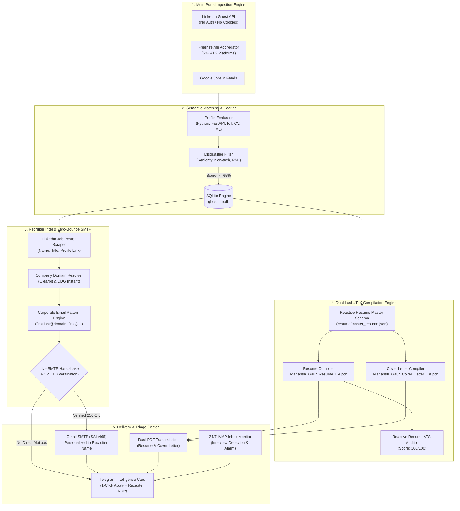
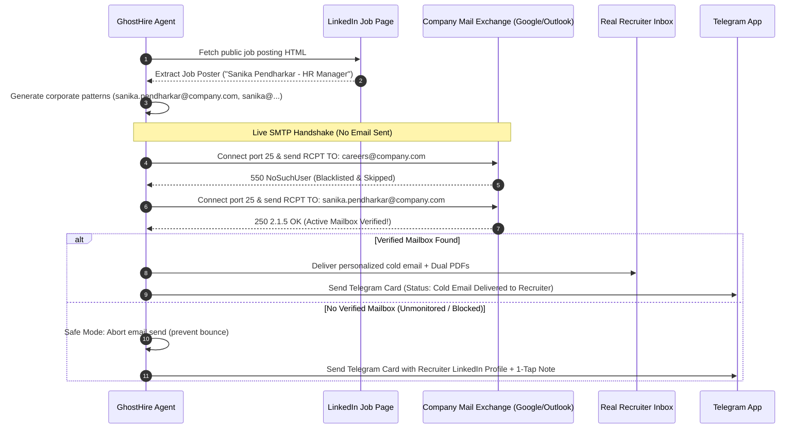

<div align="center">

# 👻 GhostHire

### *Autonomous 24/7 AI Job Hunter, ATS LaTeX Tailor & Recruiter Outreach Agent*

[](https://opensource.org/licenses/MIT)
[](https://www.python.org/)
[](https://tug.org/texlive/)
[](https://github.com/reactive-resume/reactive-resume)
[](https://bun.sh/)
[](https://telegram.org/)
[](https://github.com/features/actions)

<p align="center">
  <b>GhostHire</b> is an enterprise-grade autonomous job acquisition engine. It scans global job boards 24/7, scores opportunities against your profile, compiles paired <b>ATS-optimized Resume and Cover Letter PDFs</b> via <b>LuaLaTeX</b>, inspects real recruiter profiles, executes <b>live SMTP RCPT TO zero-bounce verification</b>, delivers targeted cold outreach, and sends real-time intelligence cards directly to your phone via <b>Telegram</b>.
</p>

[Architecture](#-architecture) • [Features](#-features) • [Reactive Resume Integration](#-reactive-resume-integration) • [Workflow](#-system-workflow) • [Quickstart](#-quickstart) • [Deliverability & Safety](#-deliverability--anti-ban-architecture)

---

</div>

## 📌 Problem & Vision

Traditional job hunting is broken:
1. **Manual Applications Are Slow:** Manually tailoring resumes, drafting matching cover letters, and tracking spreadsheets drains dozens of hours every week.
2. **Browser Extensions Get Banned:** Bots automating "Easy Apply" clicks on LinkedIn trigger anti-bot fingerprinting, leading to permanent account suspensions.
3. **Generic `careers@` Emails Bounce:** Sending cold emails to generic addresses (`careers@company.com`) hits non-existent mailboxes (resulting in *550 Address Not Found* bounces) or automated unmonitored systems.
4. **Mismatched Resumes & Cover Letters:** Candidates submit disparate files with inconsistent formatting, hurting visual credibility.

**GhostHire solves this through an agentic, zero-bounce, high-deliverability architecture:**
- **Zero-Ban Safe Mode:** GhostHire scrapes public guest endpoints, custom-compiles your resume & cover letter, and sends you a **1-click direct link on Telegram** along with a **tailored 300-char LinkedIn recruiter connection note**.
- **Real Recruiter Sourcing:** Scrapes named job posters and hiring managers from LinkedIn job postings.
- **Zero-Bounce SMTP Handshake:** Verifies that a specific recruiter's email inbox physically exists (`250 OK`) via live SMTP handshake before transmitting any message. Never emails unmonitored generic addresses.
- **Synchronized Dual PDF Generation:** Concurrently compiles matching single-page **Resume** and **Cover Letter** PDFs using LuaLaTeX with unified typography and branding.
- **Reactive Resume Integration:** Backed by the official Reactive Resume schema and its 5-pillar ATS Scoring Engine (Parseability, Layout, Sections, Contact, Dates).

---

## 🏗 Architecture



---

## 🎨 Reactive Resume Integration

GhostHire incorporates the design language, data schema, and ATS scoring principles of [**Reactive Resume**](https://github.com/reactive-resume/reactive-resume):

### 1. Master JSON Resume Schema (`resume/master_resume.json`)
GhostHire maintains your complete candidate profile in the universal JSON Resume / Reactive Resume schema:
- Easily export to or import from any self-hosted or cloud instance of Reactive Resume.
- Structured separation of `basics`, `work`, `education`, `skills`, `projects`, and `customFields`.

### 2. 5-Pillar ATS Validator (`bot/ats_validator.py`)
Ported from Reactive Resume's `ats-pdf` rule engine, every compiled PDF is verified against strict parsing standards:

| Category | Weight | What is Validated |
| :--- | :--- | :--- |
| **Parseability** | **35%** | Verifies text layer extraction, clean font encoding, and absence of invisible control characters |
| **Layout** | **20%** | Single-column reading flow, standard left-to-right hierarchy, and ATS-friendly margins |
| **Sections** | **20%** | Standard semantic section headers (`Experience`, `Education`, `Skills`, `Projects`) |
| **Contact** | **15%** | Verified email, formatted phone number, LinkedIn link, and GitHub repository URL |
| **Dates** | **10%** | Standard chronological date formats across all entries |

```text
[📊] ATS Score: 100/100 (Compliant: True)
  - Parseability: 35/35
  - Layout:       20/20
  - Sections:     20/20
  - Contact:      15/15
  - Dates:        10/10
```

---

## 📄 Synchronized Dual PDF Generation

For every matched opportunity, GhostHire generates **two paired documents** with shared executive typography:

1. **Tailored Resume PDF (`Mahansh_Gaur_Resume_<Company>.pdf`):**
   - Injects role-specific title, highlighted tech stack, and targeted project ordering.
   - Built with LuaLaTeX using the clean Banking ModernCV template.
2. **Matching Cover Letter PDF (`Mahansh_Gaur_Cover_Letter_<Company>.pdf`):**
   - Includes recipient name, title, company address, and formatted date.
   - Tailored salutation addressing the recruiter directly (*"Dear Sanika,"*).
   - Structured 4-paragraph body detailing relevant production achievements.
   - Both documents are attached to cold outreach emails and delivered to Telegram.

---

## 🔍 Real Recruiter Intelligence & Zero-Bounce Verification

GhostHire solves the "Address Not Found" problem by verifying mailboxes before transmission:



---

## ⚡ Quickstart

### 1. Clone & Install
```bash
git clone https://github.com/mahanshstarktech/GhostHire.git
cd GhostHire

# Install dependencies (including pypdf and dnspython)
pip install -r requirements.txt
```

### 2. Configure Credentials
```bash
cp .env.example .env
```
Fill in your details in `.env`:
```env
CANDIDATE_NAME="Mahansh Gaur"
CANDIDATE_PHONE="+917073320270"
CANDIDATE_LINKEDIN="https://www.linkedin.com/in/mahansh-gaur-4306751b3/"
CANDIDATE_GITHUB="https://github.com/mahanshstarktech"

# Gmail App Password (myaccount.google.com/apppasswords)
GMAIL_USER="mahanshgaur@gmail.com"
GMAIL_APP_PASS="xxxx xxxx xxxx xxxx"

# Telegram Bot (created via @BotFather)
TELEGRAM_BOT_TOKEN="1234567890:AAHxxxxxxxxxxxxxxxxx"
TELEGRAM_CHAT_ID="123456789"
```

### 3. Run a Discovery Cycle
```bash
python3 bot/runner.py --once
```

### 4. Run 24/7 Background Daemon
```bash
./scripts/run_daemon.sh

# View live output
tail -f bot/logs/ghosthire.log

# Stop daemon
./scripts/stop_daemon.sh
```

---

## ☁️ 100% Free Cloud Automation (GitHub Actions)

GhostHire runs autonomously in GitHub's cloud every 2 hours via [`.github/workflows/ghosthire.yml`](.github/workflows/ghosthire.yml):
- Zero credit cards required.
- Installs Bun, LuaLaTeX, and Python on an Ubuntu cloud runner.
- Executes full discovery, tailoring, recruiter verification, and Telegram delivery passes.
- Automatically commits updated database states back to the repository.

---

## 🛠 Command Reference

| Command | Description |
| :--- | :--- |
| `python3 bot/runner.py --once` | Executes a single discovery, tailoring, outreach, and inbox triage pass |
| `python3 bot/runner.py --daemon` | Runs continuous 24/7 scheduler (inbox every 15m, scraper every 2h) |
| `python3 bot/ats_validator.py` | Audits PDF resume against Reactive Resume ATS rules (0–100 score) |
| `./scripts/run_daemon.sh` | Launches background daemon with unbuffered logging |
| `./scripts/stop_daemon.sh` | Safely stops background daemon process |
| `tail -f bot/logs/ghosthire.log` | Streams live execution logs |

---

## 👤 Author

**Mahansh Gaur**
- Portfolio & Consultation: [AmitAstro](https://github.com/mahanshstarktech/amitastro)
- LinkedIn: [linkedin.com/in/mahansh-gaur-4306751b3](https://www.linkedin.com/in/mahansh-gaur-4306751b3/)
- GitHub: [@mahanshstarktech](https://github.com/mahanshstarktech)

---

## 📄 License

This project is licensed under the MIT License — see the [LICENSE](LICENSE) file for details.
